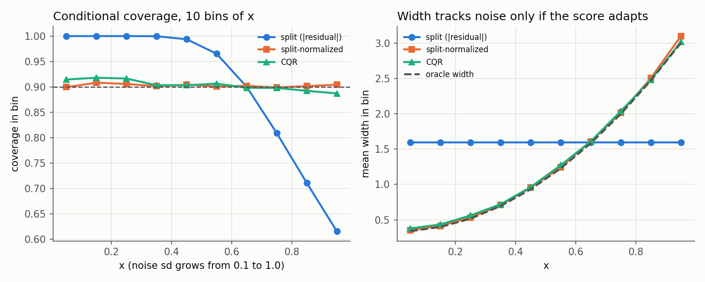
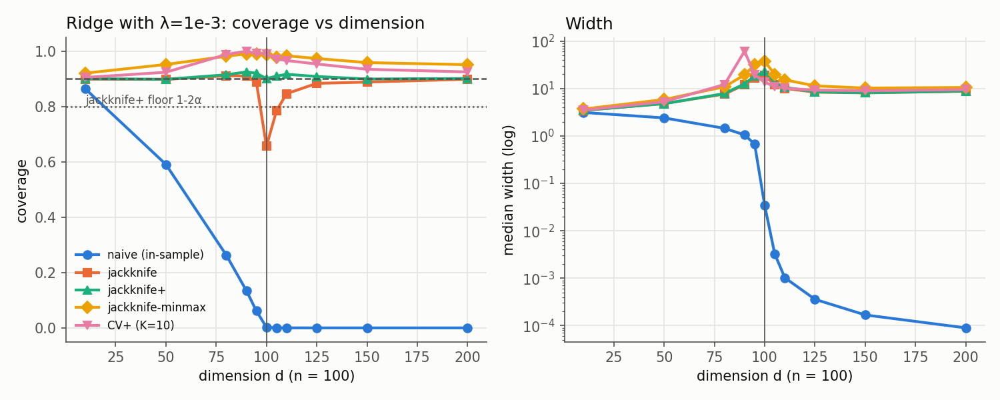
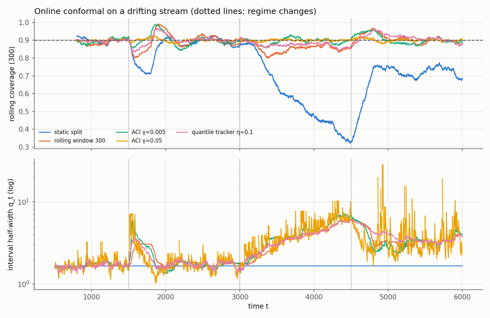

# conformal-coverage-lab

Conformal prediction methods built from scratch, each tested against the theorem that is supposed to justify it.

Conformal prediction turns any point predictor into prediction intervals with a
**finite-sample, distribution-free** coverage guarantee. The guarantees are
precise mathematical statements, which makes them good test oracles:

| method | guarantee checked here |
|---|---|
| split conformal | 1 − α ≤ P(cover) ≤ 1 − α + 1/(n+1); coverage given the calibration set ~ Beta(k, n+1−k) |
| full conformal (ridge) | same marginal window; the exact set equals brute-force refitting at every candidate label |
| jackknife+ / CV+ | ≥ 1 − 2α for *any* symmetric algorithm (plain jackknife has no guarantee) |
| jackknife-minmax | ≥ 1 − α |
| weighted conformal | ≥ 1 − α under known covariate shift |
| ACI (online) | \|avg error − α\| ≤ (max(α₁, 1−α₁) + γ)/(γT) for **every** sequence, even adversarial ones |

Every data generator has Gaussian noise with a known mean and scale. So the
coverage of an interval is computed **exactly** as
Φ((hi − f(x))/σ(x)) − Φ((lo − f(x))/σ(x)), not estimated from a finite test set.
The only randomness left in an experiment is the train/calibration draw, and
that draw is what the theorems are about.

## Highlights

All numbers are from simulations on synthetic data (`results/results.md`, fixed seeds).

- **The Beta law holds.** Over 2,000 calibration draws, the realized coverage
  distribution matches Beta(k, n+1−k) at n_cal = 20, 100, and 1000. All KS
  p-values are ≥ 0.16, and the simulated sd is within 0.001 of theory. With standard split
  conformal at n_cal = 100, **47% of calibration sets give coverage below
  90%** (theory: 45%). The PAC rank correction (k = 95 instead of 91) cuts this
  to 5.9% (theory: 5.8%), at the cost of 28% wider intervals.
- **Marginal ≠ conditional.** Under 10× heteroscedastic noise, split
  conformal with |residual| scores has 0.899 marginal coverage but **0.615 in
  the noisiest decile and 1.000 in the quietest**. Normalized scores and CQR
  keep every decile within [0.887, 0.918] and come within 2% of the oracle
  width.
- **Plain jackknife fails where the theory says it can.** With ridge
  (λ = 1e-3) at d = n = 100, jackknife coverage drops to **0.656**, while
  jackknife+ stays at 0.901 (floor 0.8). The in-sample "naive" method reaches
  0.002. CV+ has a width spike at d = 90, where each 90-point training fold
  interpolates.
- **Weighted conformal fixes covariate shift.** When test x is tilted toward
  the noisy region (θ = 12), unweighted split coverage falls to 0.647. The
  likelihood-ratio-weighted version holds 0.903 while the calibration ESS
  drops from 500 to 84. Normalized scores are nearly pivotal, so they are
  also robust (0.893) *without* weights.
- **ACI on a drifting stream.** A static calibration drops to 0.32 rolling
  coverage during a noise ramp. ACI (γ = 0.05) holds 0.899–0.902 in every
  regime and has the best worst-window coverage (0.880). The cost is visible:
  2.6% of its intervals are infinite, which is how ACI pays back its error
  budget.
- **Exact full conformal is cheap for ridge.** An O(n log n) sweep over root
  events gives the exact prediction set in 0.24 ms per test point at n = 1600.
  That is about 100× faster than a 1000-point refit grid, which is also only
  approximate. (Python wall-clock; relative comparison only.)

## How exact full conformal works

Full conformal accepts label y at x if, after refitting on all n+1 points,
the test residual is not in the top α fraction. Ridge's fitted values are
linear in the response vector, so every residual is affine in the candidate label:

```
r(y) = (I − H)[y₁,…,yₙ,0]ᵀ + y·(I − H)e_{n+1} = a + b·y
```

Each comparison `|aᵢ + bᵢy| ≥ |a_{n+1} + b_{n+1}y|` is the sign of a quadratic
qᵢ(y). The conformity count N(y) = Σᵢ 1{qᵢ(y) ≥ 0} is therefore piecewise
constant:

1. Compute a and b in O(nd²) without forming H (one d×d solve with two right-hand sides).
2. For each i, read 1{qᵢ ≥ 0} at y = −∞ from the leading coefficient, and emit
   a ±1 toggle at each real root. A double root emits two cancelling toggles.
3. Sort ≤ 2n events and take a cumulative sum to get N on every region. Keep
   the regions with N + 1 > α(n+1) and merge adjacent ones.

The result is an exact union of intervals. It can be non-convex or unbounded.
It is tested against brute-force refitting on 3,001-point grids across 24
random instances (n from 12 to 300), including d > n.

## Layout

```
conformal/
  data.py        synthetic generators with closed-form conditional coverage; tilted shift; drift stream
  models.py      ridge, linear quantile regression (HiGHS LP), closed-form ridge leave-one-out
  split.py       split / normalized / CQR / weighted conformal, Beta coverage law, PAC rank
  full_ridge.py  exact full-conformal ridge (root sweep) + brute-force reference
  jackknife.py   naive, jackknife, jackknife+, jackknife-minmax, CV+
  online.py      RLS predictor, ACI, quantile tracking, static and rolling baselines
experiments/     E1–E7, run by run_all.py
tests/           exactness and guarantee tests
results/         results.md (generated)
figures/         PNG figures (generated)
```

## Usage

Requires Python ≥ 3.10 with NumPy, SciPy and Matplotlib.

```bash
pip install -r requirements.txt
python3 -m unittest discover -s tests -t .     # 20 tests, ~2 s
python3 -m experiments.run_all                 # all experiments, ~15 s; rewrites results/ and figures/
```

Library use:

```python
import numpy as np
from conformal import Ridge, split_abs, jackknife_plus, full_conformal_ridge
from conformal.data import sample_hetero, rbf_features

rng = np.random.default_rng(0)
x, y = sample_hetero(400, rng)
X = rbf_features(x)
lo, hi = split_abs(Ridge(1e-2), X[:200], y[:200], X[200:300], y[200:300], X[300:], alpha=0.1)
lo, hi = jackknife_plus(X[:300], y[:300], X[300:], lam=1e-2, alpha=0.1)
intervals = full_conformal_ridge(X[:300], y[:300], X[300], lam=1e-2, alpha=0.1)  # rows of [lo, hi]
```

## Experiments

| | question | figure |
|---|---|---|
| E1 | Do all eight methods reach 90% marginally, and what do they cost in width and time? | `e1_marginal.png` |
| E2 | Is the coverage given the calibration set Beta-distributed? Does the PAC correction work? | `e2_beta_law.png` |
| E3 | How far is marginal from conditional coverage under heteroscedastic noise? | `e3_conditional.png` |
| E4 | When does plain jackknife fail, and does jackknife+ hold its 1 − 2α floor? | `e4_jackknife.png` |
| E5 | Does likelihood-ratio weighting restore coverage under covariate shift? | `e5_covariate_shift.png` |
| E6 | How do static, rolling, ACI and quantile-tracking methods behave on a drifting stream? | `e6_online.png` |
| E7 | How does exact full conformal scale against grid refits, jackknife+ and split? | table |





## Testing

The tests check exact identities, not just smoke runs:

- closed-form ridge LOO residuals and LOO test predictions vs n explicit refits;
- exact full-conformal sets vs brute-force refitting, including a d > n case;
- CV+ with K = n reproduces jackknife+ exactly;
- q⁺/q⁻ ranks, including the `1000 × 0.9 = 900.0000000000001` float trap;
- LP optimality of quantile regression (counts below/at the fit bracket τn);
- the Beta coverage law via a KS test, the E[coverage] = k/(n+1) identity, and PAC control;
- full-conformal marginal coverage inside [1 − α, 1 − α + 1/(n+1)] over 3,000 trials;
- the jackknife+ and minmax floors in the unstable d = n regime;
- the ACI and quantile-tracker long-run bounds on adversarial sequences
  (alternating, collapsing, blockwise-exploding scores);
- one-step-ahead causality of RLS, plus a regression test for its covariance blow-up.

## Findings worth discussing

- **Coverage "on average" is not coverage for your calibration set.** With
  n_cal = 100 the realized coverage has sd 0.03. Almost half of deployments
  land below target, and PAC ranks are the cheap fix.
- **Jackknife+ and full conformal produce practically identical intervals here**
  (width 1.651 vs 1.651). Ridge with n = 200 and d = 13 is stable, so the
  difference between methods only matters in regimes like E4.
- **Engineering bug found by the experiments:** recursive least squares with
  forgetting 0.99 diverged in the heavy-tailed regime. The covariance matrix
  lost symmetry and its top eigenvalue reached ~10¹². At first this looked
  like "ACI needs huge intervals". Re-symmetrizing P fixed it. This is a
  reminder that a coverage guarantee says nothing about whether the
  intervals are useful.
- **The first exact full-conformal version was O(n²)**, because it counted at
  every probe point. By n = 1600 it was slower than the 1000-point refit
  grid it was supposed to beat (34 ms vs 23 ms per point). The event sweep
  fixed the scaling (34 ms → 0.24 ms).
- **HiGHS numerical status.** On about 1 in 80 nearly collinear RBF designs, the
  default HiGHS solver returned a non-optimal status. The quantile LP now
  retries with interior point.

## Limitations

- All data are synthetic and low-dimensional, with a known noise law. This is
  deliberate, to get exact coverage, but it is not a benchmark on real data.
- Base models are linear in fixed features (ridge, linear quantile regression).
  Conformal wrappers are model-agnostic, but the exact full-conformal sweep
  only applies to models that are linear in y (ridge, kernel ridge, and
  similar smoothers).
- Weighted conformal uses the *true* likelihood ratio. Estimating it is a
  separate problem and is not addressed.
- ACI and quantile-tracker step sizes are hand-picked. No step-size
  adaptation (e.g. DtACI) is included.
- Timings are single-machine Python wall-clock and only meaningful relative
  to each other.

## References

- Vovk, Gammerman & Shafer, *Algorithmic Learning in a Random World* (2005). Ridge-regression confidence machine.
- Lei, G'Sell, Rinaldo, Tibshirani & Wasserman, *Distribution-Free Predictive Inference for Regression* (2018).
- Romano, Patterson & Candès, *Conformalized Quantile Regression* (2019).
- Tibshirani, Barber, Candès & Ramdas, *Conformal Prediction Under Covariate Shift* (2019).
- Barber, Candès, Ramdas & Tibshirani, *Predictive Inference with the Jackknife+* (2021).
- Gibbs & Candès, *Adaptive Conformal Inference Under Distribution Shift* (2021).
- Angelopoulos, Candès & Tibshirani, *Conformal PID Control for Time Series Prediction* (2023).
- Vovk, *Conditional Validity of Inductive Conformal Predictors* (2012). Training-conditional (PAC) validity.

## License

MIT
