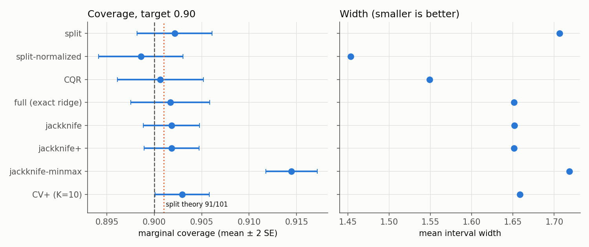
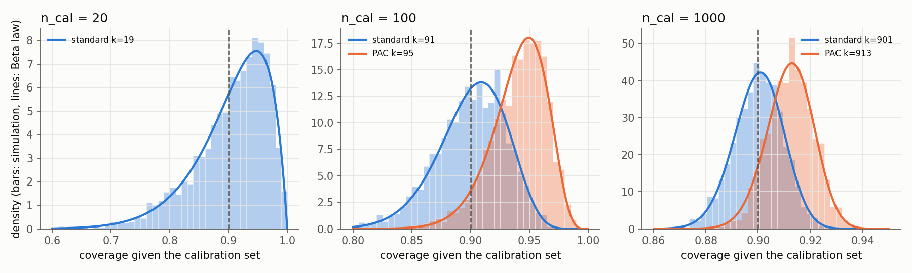
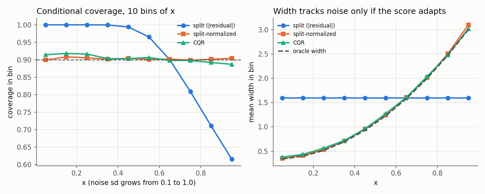
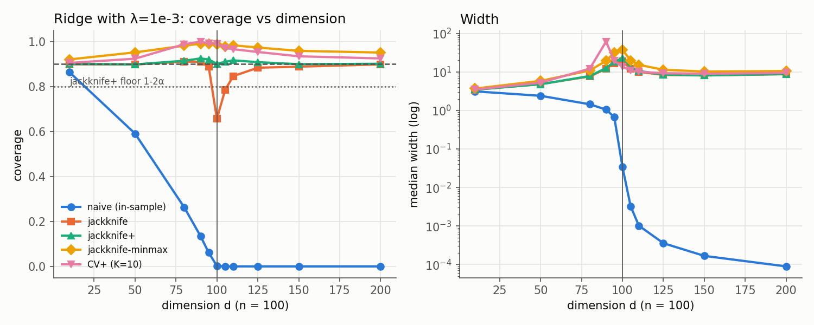
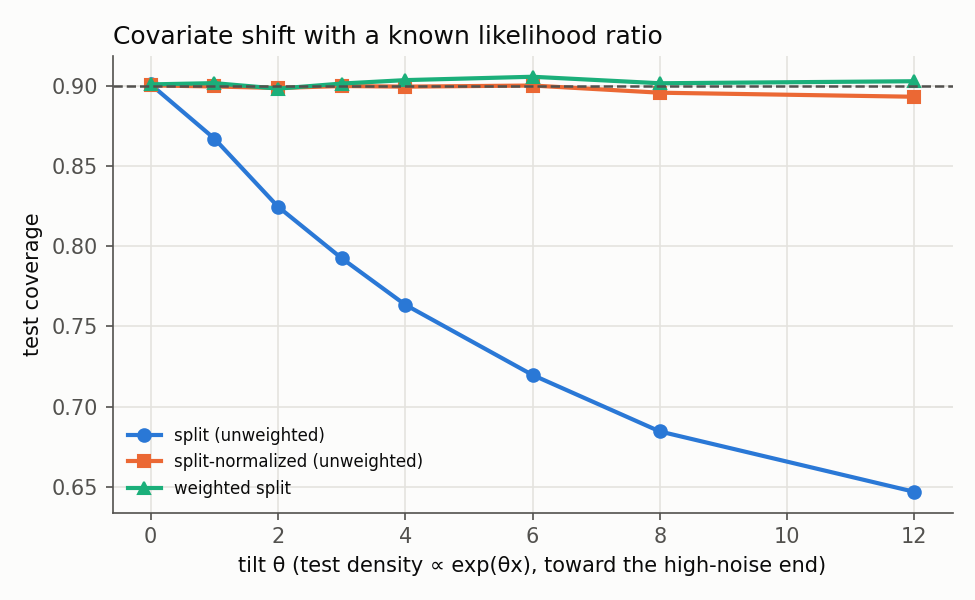
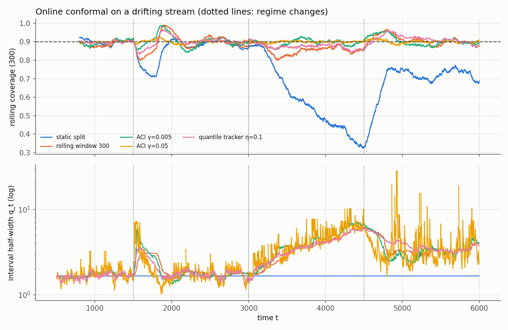

# Results

Generated by `python3 -m experiments.run_all` (fixed seeds). All data are synthetic with a known conditional law. Coverage is computed exactly from the Gaussian CDF, not estimated from held-out samples, except in E6 (a single realized stream). Timings are Python wall-clock.

## E1. Marginal coverage, width and cost

n = 200 (split methods: 100 train / 100 calibration), alpha = 0.1, 200 trials; heteroscedastic sine data, 13 RBF features, ridge lambda = 0.01. Coverage is exact per test point (Gaussian CDF), averaged over 300 uniform test x per trial (30 for full conformal). Split theory: E[coverage] = k/(n_cal+1) = 91/101 = 0.9010. Time is Python wall-clock per test point, including fitting, on one machine.

| method | coverage | SE | sd across draws | mean width | µs / test point |
|---|---|---|---|---|---|
| split | 0.902 | 0.0020 | 0.028 | 1.706 | 0.1 |
| split-normalized | 0.899 | 0.0022 | 0.032 | 1.453 | 0.1 |
| CQR | 0.901 | 0.0023 | 0.032 | 1.549 | 11.9 |
| full (exact ridge) | 0.902 | 0.0021 | 0.029 | 1.651 | 83.6 |
| jackknife | 0.902 | 0.0015 | 0.021 | 1.652 | 0.5 |
| jackknife+ | 0.902 | 0.0015 | 0.021 | 1.651 | 1.4 |
| jackknife-minmax | 0.914 | 0.0013 | 0.019 | 1.718 | 0.7 |
| CV+ (K=10) | 0.903 | 0.0014 | 0.020 | 1.659 | 2.6 |

## E2. Calibration-conditional coverage is Beta; PAC correction

2000 independent train/calibration draws per row (100 training points). Coverage for each draw is computed exactly by quadrature over x. The theory columns are Beta(k, n+1-k). PAC rows use the smallest k with P(coverage < 0.9) <= 0.1. With n_cal = 20 no k <= n achieves this, so the PAC interval would be infinite.

| n_cal | rank rule | k | theory mean | sim mean | theory sd | sim sd | KS p | theory P(cov<0.9) | sim P(cov<0.9) | mean width |
|---|---|---|---|---|---|---|---|---|---|---|
| 20 | standard | 19 | 0.9048 | 0.9042 | 0.0626 | 0.0635 | 0.708 | 0.392 | 0.387 | 1.897 |
| 100 | standard | 91 | 0.9010 | 0.9001 | 0.0296 | 0.0300 | 0.168 | 0.451 | 0.470 | 1.700 |
| 100 | PAC | 95 | 0.9406 | 0.9406 | 0.0234 | 0.0237 | 0.797 | 0.058 | 0.059 | 2.169 |
| 1000 | standard | 901 | 0.9001 | 0.9000 | 0.0095 | 0.0094 | 0.639 | 0.485 | 0.476 | 1.665 |
| 1000 | PAC | 913 | 0.9121 | 0.9124 | 0.0089 | 0.0087 | 0.170 | 0.092 | 0.076 | 1.779 |

## E3. Conditional coverage under heteroscedastic noise

40 trials, 1000 train / 1000 calibration points, exact per-x coverage averaged within 10 equal-width bins of x. All three methods are marginally valid. Only adaptive scores are close to conditionally valid.

| method | marginal | worst bin | best bin | mean width | width / oracle |
|---|---|---|---|---|---|
| split (|residual|) | 0.899 | 0.615 | 1.000 | 1.597 | 1.21 |
| split-normalized | 0.903 | 0.899 | 0.908 | 1.343 | 1.02 |
| CQR | 0.904 | 0.887 | 0.918 | 1.348 | 1.02 |
| oracle (true 5%/95% quantiles) | 0.900 | 0.900 | 0.900 | 1.316 | 1.00 |

Per-bin coverage:

| x bin | split (|residual|) | split-normalized | CQR |
|---|---|---|---|
| 0.0–0.1 | 1.000 | 0.899 | 0.914 |
| 0.1–0.2 | 1.000 | 0.908 | 0.918 |
| 0.2–0.3 | 1.000 | 0.906 | 0.916 |
| 0.3–0.4 | 1.000 | 0.901 | 0.903 |
| 0.4–0.5 | 0.994 | 0.904 | 0.903 |
| 0.5–0.6 | 0.965 | 0.901 | 0.906 |
| 0.6–0.7 | 0.900 | 0.902 | 0.898 |
| 0.7–0.8 | 0.809 | 0.899 | 0.898 |
| 0.8–0.9 | 0.711 | 0.901 | 0.892 |
| 0.9–1.0 | 0.615 | 0.904 | 0.887 |

## E4. Jackknife vs jackknife+ as ridge becomes unstable

n = 100, X ~ N(0, I_d), ||beta||² = 10, unit noise, ridge lambda = 0.001, 50 trials per d, exact coverage over 200 test points. Cells show coverage / median width.

| d | naive (in-sample) | jackknife | jackknife+ | jackknife-minmax | CV+ (K=10) |
|---|---|---|---|---|---|
| 10 | 0.863 / 3.1 | 0.899 / 3.5 | 0.900 / 3.5 | 0.920 / 3.7 | 0.905 / 3.5 |
| 50 | 0.591 / 2.4 | 0.898 / 4.8 | 0.898 / 4.8 | 0.952 / 5.9 | 0.924 / 5.3 |
| 80 | 0.263 / 1.4 | 0.911 / 7.6 | 0.915 / 7.8 | 0.981 / 10.9 | 0.988 / 12.2 |
| 90 | 0.135 / 1.1 | 0.910 / 12.0 | 0.925 / 12.6 | 0.990 / 19.4 | 1.000 / 61.5 |
| 95 | 0.061 / 0.7 | 0.887 / 16.8 | 0.920 / 18.3 | 0.990 / 31.9 | 0.991 / 19.4 |
| 100 | 0.002 / 0.0 | 0.656 / 18.8 | 0.901 / 23.1 | 0.988 / 37.5 | 0.991 / 13.6 |
| 105 | 0.000 / 0.0 | 0.784 / 12.0 | 0.910 / 13.6 | 0.977 / 19.9 | 0.971 / 11.0 |
| 110 | 0.000 / 0.0 | 0.846 / 10.1 | 0.916 / 10.7 | 0.983 / 15.3 | 0.966 / 10.2 |
| 125 | 0.000 / 0.0 | 0.884 / 8.4 | 0.908 / 8.5 | 0.973 / 11.4 | 0.953 / 9.3 |
| 150 | 0.000 / 0.0 | 0.888 / 8.1 | 0.899 / 8.2 | 0.959 / 10.2 | 0.934 / 9.0 |
| 200 | 0.000 / 0.0 | 0.898 / 8.8 | 0.901 / 8.8 | 0.951 / 10.5 | 0.925 / 9.5 |

## E5. Covariate shift: weighted conformal

Train/calibration x ~ U[0,1]; test x has density ∝ exp(θx). 100 trials, 500/500 split. Coverage is exact under the test distribution. The weighted method uses the true likelihood ratio. 'ESS' is the Kish effective size of the calibration weights, and 'P(inf)' is the test mass that receives an unbounded interval because the weighted calibration mass is not enough.

| θ | split (unweighted) | split-normalized (unweighted) | weighted split | weighted: finite width | ESS | weighted: P(inf) |
|---|---|---|---|---|---|---|
| 0 | 0.901 | 0.900 | 0.901 | 1.622 | 500 | 0.0000 |
| 1 | 0.867 | 0.900 | 0.902 | 1.897 | 462 | 0.0000 |
| 2 | 0.825 | 0.899 | 0.898 | 2.083 | 381 | 0.0000 |
| 3 | 0.793 | 0.900 | 0.902 | 2.297 | 302 | 0.0000 |
| 4 | 0.764 | 0.900 | 0.904 | 2.454 | 242 | 0.0000 |
| 6 | 0.720 | 0.900 | 0.906 | 2.687 | 167 | 0.0000 |
| 8 | 0.684 | 0.896 | 0.902 | 2.797 | 126 | 0.0000 |
| 12 | 0.647 | 0.893 | 0.903 | 2.975 | 84 | 0.0000 |

## E6. Online conformal under drift

T = 6000, d = 5. The predictor is one-step-ahead RLS (forgetting 0.99), and the score is |y − ŷ|. The static split is calibrated once on t ∈ [200, 500). All metrics are over t ≥ 500. Regimes: β flips at t=1500, noise sd ramps 1→4 over [3000, 4500), then Student-t(2) noise.

| method | overall | stationary | after β jump | noise ramp 1→4 | t(2) noise | worst rolling-300 | median width | P(inf) |
|---|---|---|---|---|---|---|---|---|
| static split | 0.740 | 0.903 | 0.859 | 0.531 | 0.722 | 0.323 | 3.32 | 0.0000 |
| rolling window 300 | 0.887 | 0.894 | 0.895 | 0.854 | 0.908 | 0.800 | 5.44 | 0.0000 |
| ACI γ=0.005 | 0.900 | 0.899 | 0.901 | 0.895 | 0.904 | 0.843 | 5.23 | 0.0000 |
| ACI γ=0.05 | 0.900 | 0.901 | 0.900 | 0.899 | 0.902 | 0.880 | 4.86 | 0.0260 |
| quantile tracker η=0.1 | 0.896 | 0.900 | 0.901 | 0.870 | 0.915 | 0.833 | 5.79 | 0.0000 |

ACI long-run guarantee over the whole stream: γ=0.005: |err − α| = 0.00000 ≤ bound 0.03017; γ=0.05: |err − α| = 0.00033 ≤ bound 0.00317.

## E7. Cost of exactness

Python/NumPy wall-clock on one laptop CPU, d = 13. These numbers are for relative comparison only. The grid method reuses the factorized Gram matrix but refits at 1000 candidate labels (O(grid · n d)), and it only approximates the exact set. Exact full conformal is O(n d² + n log n) per test point. Jackknife+ and split amortize one fit over all 1000 test points.

| n | exact full (ms / pt) | grid×1000 refits (ms / pt) | speedup | jackknife+ (µs / pt) | split (µs / pt) |
|---|---|---|---|---|---|
| 50 | 0.08 | 9.0 | 109 | 4.4 | 0.02 |
| 100 | 0.08 | 11.4 | 146 | 0.6 | 0.02 |
| 200 | 0.09 | 12.6 | 143 | 1.7 | 0.02 |
| 400 | 0.12 | 13.8 | 112 | 4.4 | 0.03 |
| 800 | 0.15 | 16.5 | 108 | 10.9 | 0.03 |
| 1600 | 0.24 | 23.0 | 95 | 21.2 | 0.04 |
